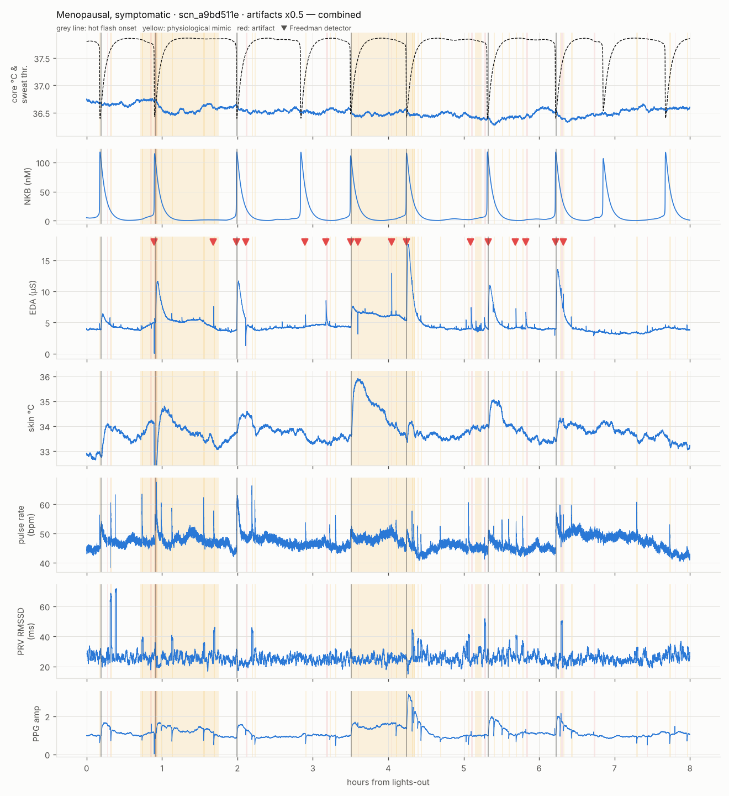
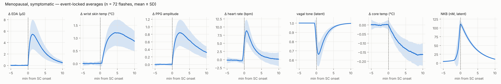

# hotflash-sim

Synthetic, labelled wearable data for menopausal hot flashes, from a mechanistic model.

[](https://github.com/ashley01062002/Oxford-Hackathon-2026/actions/workflows/hotflash-sim-ci.yml)

The model chain is:

1. A KNDy (hypothalamic) pulse generator.
2. The Freedman thermoregulatory threshold model.
3. Vagal and sympathetic responses.
4. What a wrist device would measure: electrodermal activity (EDA), PPG pulse-rate variability (PRV), PPG
   amplitude, skin temperature and movement.

It adds labelled physiological mimics and sensor artifacts, so detectors can be tested on realistic
false positives. It covers three groups: menopausal women with hot flashes, postmenopausal women without them, and
premenopausal women.

> **Research prototype.** No open dataset with hot flash–labelled EDA and PPG exists, so this
> simulator is calibrated only to published summary statistics. Most parameters are marked
> `ASSUMED`. It is not a medical device and not a substitute for real recordings.



## Install

```bash
pip install "git+https://github.com/ashley01062002/Oxford-Hackathon-2026.git#subdirectory=hotflash-sim"
```

From source:

```bash
git clone https://github.com/ashley01062002/Oxford-Hackathon-2026.git
cd Oxford-Hackathon-2026/hotflash-sim && pip install -e ".[dev]"
```

This needs Python ≥ 3.10. Dependencies: numpy, scipy, pandas, matplotlib, statsmodels.

## Quick start

```bash
hotflash-sim --quick        # ~20 s preview: tiny dataset, figures, checks -> ./outputs
hotflash-sim                # full run (~1.5 min): 18 scenarios dev/test + 20-night validation per group
hotflash-sim stream --seed 42 --speed 60 --detect     # live: one JSON frame every 500 ms (60x speed)
```

### Build and score a detector

```bash
hotflash-sim                                          # 1. make the dataset
python examples/my_detector.py --split dev            # 2. predict from observable files only
hotflash-sim score --split dev --pred preds_dev.csv   # 3. sensitivity / PPV / FP causes
hotflash-sim score --split test                       # baseline: Freedman 2 µS/30 s criterion
```

The bundled example adds two rejection rules to the Freedman criterion: movement during the EDA rise, and no skin warming. On the
default dev split this moves PPV from 0.13 to 0.79 at the same sensitivity (0.92).

### Python API

```python
from hotflash_sim import simulate_night, RealtimeStream, to_output_rate

run = simulate_night("menopausal_symptomatic", hours=8, seed=1)
run["labels"]       # every event: hot_flash / negative / artifact, with opaque IDs
run["beats"]        # detected PPG pulses (t_s, ibi_ms)
obs, latent = to_output_rate(run)   # 2 Hz observable + hidden latent tables

for frame in RealtimeStream(seed=1).frames():   # same frames as the CLI stream
    ...
```

### Other commands

```bash
hotflash-sim stream --seed 42 --speed 600 --quiet --plot-file live.png   # headless live plot
hotflash-sim verify                                   # re-hash files against the manifest
hotflash-sim params --group premenopausal             # parameter table with sources
hotflash-sim run --seed 7 --per-group 10 --set artifact_rate_scale=0     # other settings
hotflash-sim calibrate                                # re-run calibrations (~10 min)
```

## Output layout

```
outputs/dataset/manifest.json             master seed, versions, code sha256, scenario list, sha256 per file
outputs/dataset/{dev,test}/<scn_id>/
    signals_2hz.csv   t_s, eda_uS, skin_temp_C, pr_bpm, prv_rmssd_60s_ms, ppg_amp, acc_g, resp
    pulses.csv        detected PPG pulse times + inter-beat intervals (ibi_ms)
    meta.json         group, seed, hours, artifact/negative level, output rate
    params.json       every parameter (value, unit, status, source, note)
outputs/dataset/hidden/{dev,test}/<scn_id>/
    labels.csv        every event with an opaque ID (evt_xxxxxxxxxx): hot_flash, negatives, artifacts
    flash_details.csv per-flash draws (SC amp, vagal withdrawal, HR lead, NKB at onset, ...)
    latent_2hz.csv    core temp, thresholds, KNDy Dyn/NKB/firing, vagal/sympathetic, clean EDA/skin/PPG
    ecg_true.csv      true R peaks (incl. ectopic flag)
outputs/dataset/figures/dev/<scn_id>/     eda_over_time, prv_over_time, biomarkers_over_time, combined
outputs/dataset/hidden/figures/test/...   same figures for test (they show ground truth)
outputs/validation/                        literature_checks.csv, event-locked averages, PRV windows,
                                          mixed models, group summary, params_<group>.md
```

**How the export stays reproducible:**

- Each scenario's seed comes from a single master seed. Dev and test are independent children of that seed, so they never share a random stream.
- Inside a scenario, separate streams drive physiology, KNDy, negatives, artifacts and wearable physiology. Changing the artifact level therefore leaves the physiology and flash timing unchanged.
- The same seed gives byte-identical files (checked: 168/168 files).
- In the default run, scenarios cycle through artifact levels ×0.5, ×1 and ×2.

## Model, upstream to downstream

1. **KNDy pulse generator.** This is the mean-field model of Voliotis, Li et al. 2021 (eLife 10:e71252), equations 1–3:

   - dD/dt = kD·h(v) − dD·D
   - dN/dt = kN·h(v)·KD²/(D²+KD²) − dN·N
   - dv/dt = v0·tanh(I/2) − dv·v
   - I = −log((1−b)/(1+b)) + kv(e + N²/(N²+KN²))·v
   - h(v) = v²/(v²+Kv²)

   dD, dN, dv, v0, KD, KN and Kv are the paper's Table 1 values.
   The paper inferred kD, kN, kv, b and e from mouse data but publishes them only as plots. Here they were chosen by
   grid search for the pulsatile regime. The system sits just below oscillation onset, and noise in basal
   activity b triggers pulses: about 55 min apart (CV 0.47) after menopause, and about 86 min with
   estrogen lowering b.
2. **Freedman threshold model.** The sweating threshold is lowered by normalised NKB (the KNDy→MnPO NK3R route that NK3R
   antagonists block). The flash hazard is a sigmoid of (core − threshold), with a refractory period, and each
   flash cools the body.
3. **Effectors.**
   - EDA response.
   - Vagal withdrawal, correlated with EDA amplitude.
   - HR rise of 4–15 bpm, split 50/50 between vagal and sympathetic and leading EDA in 80% of flashes.
   - Respiration rise.
   - Wrist skin warming, lagging EDA.
   - PPG amplitude rise from vasodilation.
4. **Cardiac → PPG.** R peaks are generated from HR, RSA scaled by vagal tone, LF and noise. Pulse = R + PEP + PTT:
   PEP shortens with sympathetic tone, and PTT varies with respiration. Detection adds jitter. PRV is computed from the pulses
   after standard interval cleaning.
5. **Negative examples (labelled).** Arousals (HR jump, small fast SCR, PPG vasoconstriction, skin
   cooling), slow-wave-sleep EDA storms, ambient heat episodes and periodic limb movements.
6. **Artifacts (labelled).**
   - EDA motion spikes and steps.
   - Device contact loss, which hits EDA, PPG and skin temperature together.
   - Missed, extra and motion-corrupted PPG pulses, and PPG dropouts.
   - Ectopic beats.
   - EDA quantisation and saturation.

The parameters are 16 LIT, 10 DERIVED, 80 ASSUMED and 1 USER (output rate). Every one has its source and a note in
`params.json` and `outputs/validation/params_<group>.md`.

## Calibrations (`hotflash-sim calibrate`)

| fitted | to | result |
|---|---|---|
| `sweat_thresh_offset`, `kndy_threshold_drop` (jointly) | 3.52 flashes/night (de Zambotti 2014) and 51% preceded by core rise (core-temperature re-test) | 1.099 °C, 1.5 °C/N_ref. The fraction plateaus at 0.54 (SE ≈ 0.04) |
| `vagal_sc_corr` (generative) | measured r(PRV ΔlogHF, logSC) = −0.56 (de Zambotti 2013), clean recordings | −0.89 ± 0.03 |
| `kndy_threshold_drop`, non-symptomatic groups | ~0 flashes/night | 1.2 (assumed; direction from TACR3 GWAS) |



## Validation (seed 42, 20 nights per group)

| check | simulated | target |
|---|---|---|
| flashes/night (symptomatic / asymptomatic / premenopausal) | 3.65 / 0 / 0 | 3.52 / ~0 / ~0 |
| preceded by core-temp rise | 0.47 | 0.51 |
| HR rise before EDA onset | 0.82 | 0.80 |
| HR rise, 5–95th percentile | 5.0–14.3 bpm | 4–15 |
| measured r(PRV ΔlogHF, logSC) | −0.51 (n=73) | −0.56 |
| **flashes within 15 min after KNDy pulse onset** | **1.00 (chance 0.27)** | weak association (Prague 2019, P = 0.24): **conflict** |
| Freedman detector, clean: sensitivity / PPV | 0.90 / 0.90 | ~0.9 |
| Freedman detector, with artifacts + mimics | 0.86 / 0.28, about 8 FP/night | — |

The test-split baseline scores sensitivity 0.75 and PPV 0.11. Its false positives come from EDA motion (50),
contact loss (15), arousals (10) and EDA storms (2).

## Limitations

- No open hot flash–labelled EDA/PPG dataset exists, so agreement with real data is limited to published summary statistics.
- The KNDy model's inferred parameters come from mice; the human adaptation (excitable regime, noise) is an assumption.
- Fitting the 51% core-rise target makes every flash NKB-pulse-locked, which conflicts with Prague 2019.
- Artifact and mimic rates are assumed. At ×1 the EDA-only baseline gives about 8 false positives per night.
- Sleep only. No sleep staging, blood pressure or daytime.
- Dataset size is about 200 MB for 18 scenarios. The 2 Hz latent files are the bulk.
- "Real time" streams a scenario generated from its seed up front (about 1 s), released causally every 500 ms.

## References

Voliotis, Li et al. 2021 eLife 10:e71252; Voliotis et al. 2019 J Neurosci; Prague et al. 2019 JCEM
(PMC6637789); Freedman & Krell 1999; Freedman 2014 review (PMC4612529); Freedman sternal SC criterion;
core temperature revisited (LJMU eprint 10472); de Zambotti et al. 2013 (PMC3713094); de Zambotti et al. 2014;
Baker et al. 2019 Sleep (PMC6802629); Forouzanfar et al. 2018 EMBC (PMC7477890); Naghavi et al. 2025;
Crandall et al. 2017 (TACR3 and vasomotor symptoms, GWAS).

## Development

```bash
pip install -e ".[dev]" && pytest      # ~10 s smoke tests (determinism, export, stream, CLI)
```

`AGENTS.md` holds the architecture, invariants (seed streams, hidden vs observable data, parameter
rules) and open modelling questions, for human contributors and coding agents.
